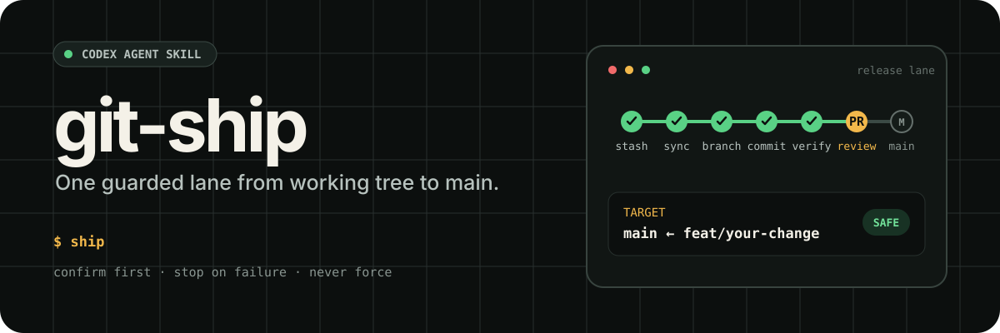
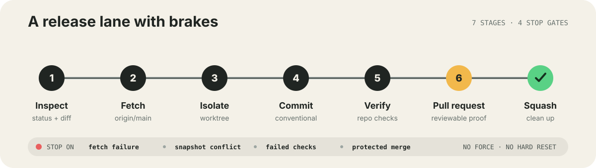

<p align="center">
  
</p>

<p align="center">
  <a href="./README.zh-CN.md">简体中文</a>
</p>

完成代码检查、分支整理、提交、推送、创建 PR 和合并，处理流程中的冲突与验证失败。

```text
working tree → latest main → new branch → commit → local checks → PR → squash merge
```

Invoking `ship` authorizes the full workflow. It generates the branch name, Conventional Commit, and PR content, resolves conflicts, fixes validation or CI failures, and continues until the PR is merged.

<p align="center">
  
</p>

## Why use it

- Keeps local changes safe while synchronizing with the latest `main`.
- Uses a fresh, descriptive branch for every shipment.
- Creates a Conventional Commit and a readable pull request summary.
- Runs the repository's existing checks and fixes failures before pushing.
- Resolves conflicts while preserving both current production behavior and the new feature.
- Reads CI logs, fixes failures, and retries until required checks pass.
- Squash-merges the PR, deletes the remote branch, and returns to an up-to-date `main`.
- Pauses only for external blockers such as missing authentication, permissions, or required human approval.

## Install

1. **Ask your Agent to install it** (recommended):

   ```text
   Please install this Skill for me: https://github.com/oil-oil/git-ship
   ```

2. **Install with the Skills CLI** (optional, requires `npx`):

   ```bash
   npx skills add oil-oil/git-ship
   ```

3. **Manual Git clone**:

   ```bash
   git clone https://github.com/oil-oil/git-ship.git ~/.agents/skills/git-ship
   ```

If your host loads skills from another directory, clone or link it there and reload skills. The entry point is `SKILL.md`.

## Usage

Finish your change, leave it uncommitted in the working tree, then ask your agent:

```text
ship
```

You can also provide the branch and commit up front:

```text
Ship this as feat/add-export with commit "feat(export): add markdown export"
```

`git-ship` shows the resolved plan and then continues immediately:

```text
📦 Ready to ship:
  Branch: feat/add-export
  Commit: feat(export): add markdown export
  Target: main ← feat/add-export (squash merge)
```

It does not ask for confirmation of the branch name, commit message, PR title, or PR body. Provide explicit names in the initial request when needed.

## How it works

| Stage | Action | Guard |
| --- | --- | --- |
| Inspect | Read working-tree changes and unpushed commits | Stops only when there is nothing to ship |
| Sync | Stash changes and fetch the latest `origin/main` | Preserves local-only commits |
| Branch | Create a unique branch or reuse the feature branch | Never duplicates the same change |
| Commit | Restore changes and commit all files | Resolves stash conflicts |
| Verify | Run documented repository checks | Fixes root causes and reruns checks |
| Publish | Push and create a PR with `gh` | Requires GitHub authentication |
| CI & Merge | Poll checks with a hard timeout (`scripts/wait_and_merge.py`), verify stale Vercel status webhooks, resync `main`, squash-merge, and clean up the remote branch | Never hangs on `gh pr checks --watch` or fails in secondary Git worktrees |
| Finish | Confirm `state == "MERGED"` and sync `main` | Never treats "PR created" or "auto-merge queued" as done |

## Requirements & Configuration

No extra configuration file or custom API key setup is required:

- Git
- [GitHub CLI](https://cli.github.com/) authenticated with `gh auth login` (reuses `gh`'s official keyring/OAuth session; never collects tokens in chat)
- Python 3.10+ (stdlib only, powers `scripts/wait_and_merge.py`)
- Optional: authenticated `vercel` CLI to verify real deployment status when GitHub Commit Status webhooks are dropped
- Repository validation commands documented in `AGENTS.md`, `README.md`, `package.json`, `pyproject.toml`, or `Makefile`

When no trustworthy validation command exists, the Skill reports that clearly instead of inventing one. Primary branch names (`main`, `master`, etc.) are detected from the repository's actual default branch.

## Security & Boundaries

Invoking `ship` authorizes the complete publishing workflow, conflict resolution, and related validation fixes. Only Git metadata, commits, and pull request calls are sent to the target GitHub remote via `git` and `gh` (and optional read-only deployment status checks via `vercel inspect` when a Vercel status context is present).

The Skill preserves current production behavior and the new feature while repairing test, lint, type, build, and CI failures. It never force-pushes, hard-resets, skips checks, publishes secrets, or weakens valid tests. Do not use `git-ship` when you only want a local commit, push, or review-only PR without merging.

## Testing

Run the unit test suite for the check-and-merge runner:

```bash
python3 -m unittest discover -s tests -v
```

## Customize

Fork the repository and edit `SKILL.md` to match your team's branch naming, merge strategy, PR template, or required checks. Keep the non-destructive recovery rules and external permission boundaries intact.

## Contributing

Issues and pull requests are welcome. Please keep changes focused, explain any new Git behavior, and include the failure path for every new action.

## License

[MIT](./LICENSE)
